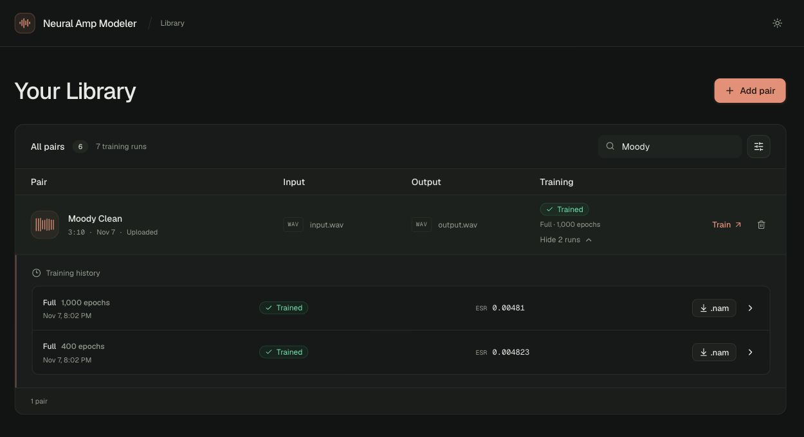
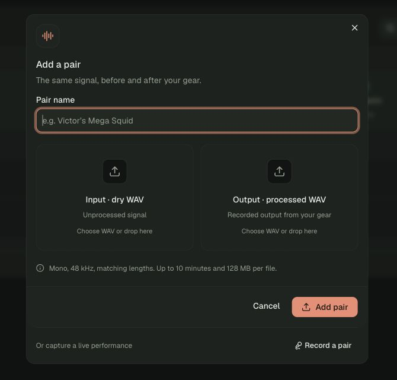
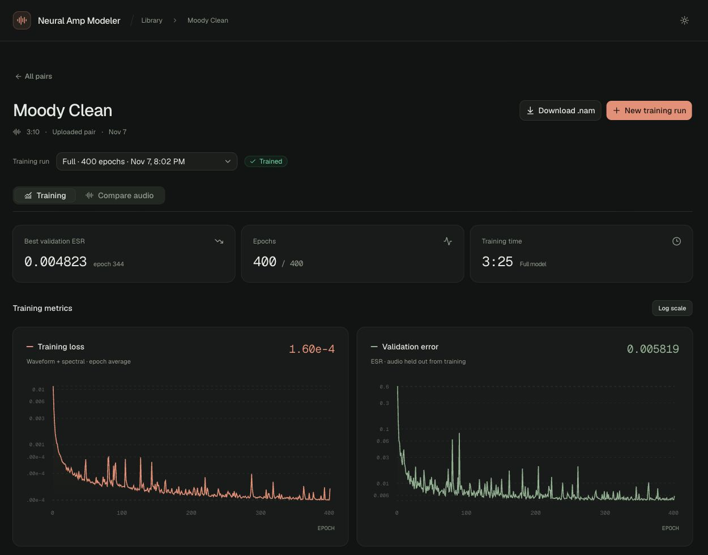

# Neural Amp Modeler

A web app for turning paired input/output WAV files into playable Neural Amp Modeler models. Upload your audio, train on Modal GPUs, and download a `.nam` file. Organize pairs and training runs in one library.



## Run your own app

You need [uv](https://docs.astral.sh/uv/getting-started/installation/), Git, and a [Modal account](https://modal.com). Python 3.12+ is required; uv can install it automatically.

```sh
git clone https://github.com/DrChrisLevy/neural-amp-modeler.git
cd neural-amp-modeler

uv sync
uv run modal setup
uv run modal deploy --strategy recreate modal_app.py
```

Open the web URL printed by the deployment. Modal creates the app and its `neural-amp-modeler-data` storage volume in your active workspace. Audio and trained models persist there between visits.

**This is a public demo with a shared library.** Anyone with your deployment URL can upload, train, download, and delete pairs.

## Upload a WAV pair

Bring two files containing **the same signal before and after processing**:

| File | What it contains |
| --- | --- |
| Input · dry WAV | The unprocessed signal sent into your gear. |
| Output · processed WAV | That signal recorded after passing through your gear. |

For a new capture, start with [NAM's standard input.wav](https://drive.google.com/file/d/1KbaS4oXXNEuh2aCPLwKrPdf5KFOjda8G/view). Play it through your gear and record the processed result, then upload the original file as **Input** and your recording as **Output**.

Both files must be **mono, 48 kHz, and exactly the same length**.

1. In **Your Library**, click **Add pair**.
2. Name the pair and choose or drop your input and output WAVs.
3. Click **Add pair**. Progress appears on the new library row, and you can upload more pairs while it finishes.



## Train and download

1. Click **Train** on a pair. The app trains an **A2 Full** model; choose an epoch count (default **400**) and click **Start training**.
2. Open the run to watch its training curves. Runs are saved separately, so you can try different epoch counts and train multiple runs concurrently, subject to your Modal quota. Training continues if you close the tab.
3. When it finishes, click **Download .nam** on the results page, or expand **View runs** in the library and use that run's download button.

Downloads include the pair name and epoch count, for example `my_amp_400_epochs.nam`. Each new run exports one Full model, using its best validation checkpoint. Load it in a NAM-compatible player that supports A2 models.

The **Compare audio** tab lets you listen to the dry signal, recorded reference, and model output. Click a waveform to play from that position; click a row's label to switch sounds at the same playback position.



## Quad Cortex Mini (optional)

If you already have WAV pairs, the steps above are all you need. Mini users can also create pairs over USB.

### Capture with the standard NAM test WAV

The automated capture command supports **macOS and Mini CorOS 4.1.1** through the unofficial [qc-mcp](https://github.com/lexasoft123/qc-mcp) adapter. It plays [NAM's standard input.wav](https://drive.google.com/file/d/1KbaS4oXXNEuh2aCPLwKrPdf5KFOjda8G/view) through your selected preset and records the processed output.

Connect the Mini by USB and set its USB assignment to **1/2 dry, 3/4 wet**. Choose the preset and scene, disable delay, reverb, and modulation, then **quit Cortex Control and stop the live bridge and other audio apps**. Keep the Mini connected and its controls unchanged. Run:

```sh
uv sync --extra capture
uv run neural-amp-modeler input
uv run --extra capture neural-amp-modeler capture --name "My preset"
```

The `input` command automatically downloads the WAV to `.data/input.wav` the first time and reuses it on later runs. The `capture` command uses that saved file. Capture takes about **3 minutes 10 seconds** plus setup and restores the original input routing afterward. Upload `input.wav` and `output.wav` from the new timestamped folder under `.data/pairs/`, then train as usual.

### Record yourself playing

Connect the Mini by USB, choose your preset and scene, and set its USB assignment to **1/2 dry, 3/4 wet** at **48 kHz**. Disable delay, reverb, and modulation for the sound you want to model.

From the repository folder, run:

```sh
uv run neural-amp-modeler bridge --url "YOUR_MODAL_WEB_URL"
```

Replace `YOUR_MODAL_WEB_URL` with your deployment's URL. In the app, choose **Add pair → Record a pair**. The connection is detected automatically. The bridge captures dry USB channel 1 and processed channel 3 while you play; stopping the recording saves the pair to your library. Keep Terminal open while recording, and press **Ctrl+C** there when finished.
